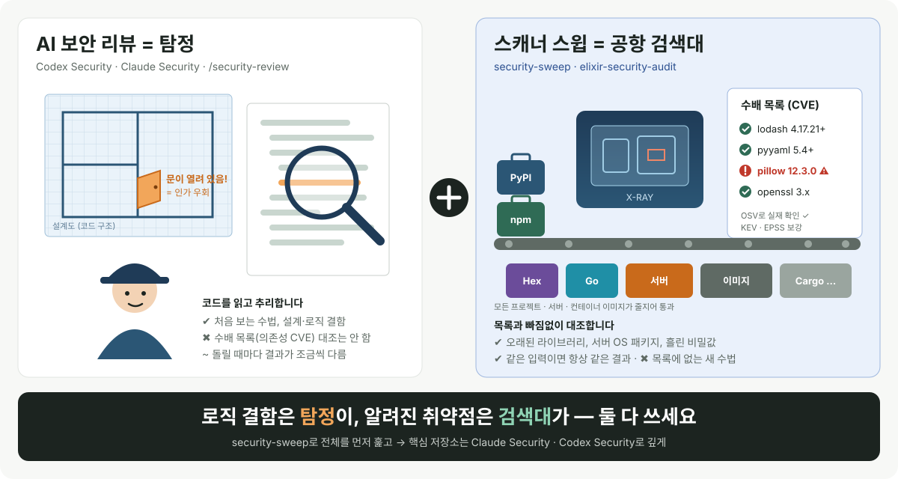
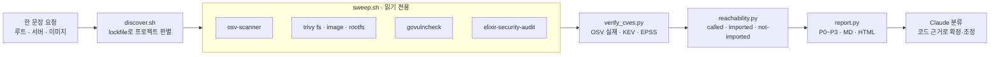

<div align="center">

# security-sweep

**한 문장으로 여러 프로젝트 · 서버 · 컨테이너 이미지의 알려진 취약점을 한 번에 훑는 Claude Code 스킬**

[](https://github.com/baryonlabs/security-sweep/actions/workflows/ci.yml)
[](https://github.com/baryonlabs/security-sweep/releases)
[](LICENSE)


[빠른 시작](#빠른-시작) · [동작 방식](#동작-방식) · [우선순위](#우선순위) · [다른 도구와 비교](#다른-보안-도구와-무엇이-다른가) · [FAQ](#faq) · [English](#english)

</div>

```text
> /security-sweep:security-sweep ./work 전체 점검해줘

● 도구 확인: osv-scanner ✓ trivy ✓ govulncheck ✗ (Go는 grep으로 추정)
● 탐색: 프로젝트 6개 (npm · PyPI · Hex · Go · Cargo + 비밀값 샘플)
● 스캔 → OSV 검증 → 도달성 → 보고서
● 자동 판정:   P0 1 · P1 11 · P2 9 · P3 2
● 코드 확인 후: P0 0 · P1 6 · P2 15 · P3 2   (조정 12건, 사유는 triage.md)
    - go-app  GO-2021-0113  P0→P1  language.Parse 인자가 상수라 외부 입력이 닿지 않음
    - py-app  pyyaml 5.3    P1→P2  safe_load만 사용, 취약한 full_load 미사용
    - rust-app smallvec     P1→P2  취약 함수 insert_many 미사용
● 수정 명령 제안 (실행하지 않음): npm audit fix · mix deps.update sweet_xml · cargo update -p smallvec …
```

<sub>위는 이 저장소의 `test/fixtures`를 새 Claude Code 세션에서 실제로 돌린 결과를 줄인 것입니다. 실제 개발 머신 26개 프로젝트 결과는 [예시 폴더](examples/dev-machine-2026-10-23)에 있습니다.</sub>

**osv-scanner와 trivy로 훑고 → 모든 CVE/GHSA ID를 OSV API로 실재 검증하고 → CISA KEV·EPSS로 보강하고 → 코드에서 실제로 쓰는지(도달성) 판정해 → P0~P3 우선순위 보고서를 만듭니다.** 기본은 읽기 전용이고, 서버에는 아무것도 설치하지 않습니다.

## 왜 만들었나

비슷한 도구는 이미 있습니다. 각자 잘하는 범위가 다릅니다:

- **secondsky 의 vulnerability-scanning 스킬** — 단일 저장소의 의존성·코드 스캔 절차를 잘 안내합니다.
- **Cornjebus/security-analyzer** — 한 코드베이스에 대한 심층 보안 분석(코드 리뷰 중심)입니다.
- **osv-mcp** — OSV 데이터베이스를 MCP 도구로 조회하게 해 줍니다. 조회 수단이지 스윕 워크플로는 아닙니다.
- **raptor** — 공격적 보안 리서치·퍼징·익스플로잇 검증 쪽 에이전트 프레임워크입니다.

그런데 "**내 체크아웃 디렉터리 수십 개 + 서버 몇 대 + 운영 이미지**를 한 번에 돌리고, 스캐너가 내놓은 ID 가 진짜인지 확인하고, 실제 코드에서 쓰는 것부터 보여 줘" 를 한 번에 하는 스킬은 찾지 못했습니다. 특히 LLM 은 CVE 번호 생김새만 보고 "가짜 같다"고 판단하는 실수를 합니다 — 예를 들어 `CVE-2026-97853` 은 이상해 보여도 OSV 에 실재하는 Elixir `decimal` DoS 취약점(`GHSA-6c27-994x-c52f`)이고, 반대로 그럴듯한 ID 가 404 일 수도 있습니다. 이 스킬은 **판단을 OSV 조회 결과에만** 근거하게 합니다.

## 다른 보안 도구와 무엇이 다른가

### 쉽게 말하면: 탐정과 공항 검색대



| | **탐정** — AI 보안 리뷰<br/><sub>Codex Security · Claude Security · `/security-review`</sub> | **공항 검색대** — 스캐너 스윕<br/><sub>security-sweep · elixir-security-audit</sub> |
|---|---|---|
| 하는 일 | 코드를 처음부터 **읽고 추리**해서 "이 문은 잠겨 있지 않네" 같은 **설계·로직 결함**을 찾습니다 | 모든 가방(프로젝트·서버·이미지)을 통과시키며 **수배 목록(CVE DB)에 오른 위험물**을 빠짐없이 찾습니다 |
| 잘 찾는 것 | 인가 우회, 잘못된 신뢰 경계, 처음 보는 수법 | 오래된 라이브러리, 서버 OS 패키지 취약점, 흘린 비밀값, 언어별 위험 API |
| 놓치기 쉬운 것 | 수배 목록 대조 (의존성 CVE는 직접 안 봄) | 목록에 없는 새로운 수법 |
| 결과 | 똑똑하지만 돌릴 때마다 조금씩 다름 | 같은 입력이면 **항상 같은 결과** |
| 확인 방법 | 다른 에이전트가 한 번 더 검증 | 수배 목록이 **진짜인지 OSV로 조회**하고, 그 물건을 **실제로 꺼내 쓰는지(도달성)** 확인 |
| 비용 | 모델 토큰 (스캔마다) | 스캐너는 무료, LLM은 분류할 때만 |

**그래서 둘 다 씁니다.** 검색대로 알려진 위험을 먼저 전부 걸러내고, 중요한 저장소는 탐정에게 맡겨 숨은 로직 결함을 찾습니다.

| 이럴 때 | 이것부터 |
|---|---|
| "우리 프로젝트·서버 전체에 알려진 취약점 있나?" | **security-sweep** |
| "이 Phoenix 앱 고쳐 줘" | **elixir-security-audit** |
| "PR 하나 머지 전에 빨리 봐 줘" | `/security-review` |
| "결제·인증 같은 핵심 저장소를 깊게 털어 줘" | **Claude Security** 또는 **Codex Security** |


### 자세히 비교


| | OpenAI **Codex Security** | Claude Code **`/security-review`** | Anthropic **Claude Security** 플러그인 | **elixir-security-audit** | **security-sweep** |
|---|---|---|---|---|---|
| 접근 방식 | LLM이 코드를 읽고 탐지 (CLI·SDK·Codex 플러그인·GitHub Action) | LLM 1회 보안 패스 | LLM 멀티에이전트 (아키텍처 → 위협 모델 → 탐색 → 독립 검증) | 결정적 스캐너 + LLM 분류·수정 | 결정적 스캐너 + LLM 분류 |
| 범위 | 저장소·경로·diff, deep 모드, 여러 저장소 bulk 스캔 | 현재 브랜치 | 저장소 전체·일부, 브랜치·PR·커밋 diff | Elixir/Phoenix 프로젝트 1개 | 디렉터리 아래 모든 프로젝트 + 서버 + 컨테이너 이미지 |
| 의존성 CVE | 직접 스캔하지 않음 (Snyk·Endor 결과 가져오기) | 다루지 않음 | 다루지 않음 (공식 문서: 기존 의존성 스캐너와 병행 권장) | mix_audit · hex.audit · OSV | OSV-Scanner (전 생태계) |
| CVE 실재 검증 | — | — | — | OSV 대조 | OSV 조회 + CISA KEV + EPSS |
| 수정 | `cs patch`, `verify-fix` | 보고 중심 | `patches/`에 패치 파일, 자동 적용 안 함 | 별도 브랜치에 커밋 (승인 후) | 읽기 전용, 언어별 스킬로 넘김 |
| LLM 없이 실행 | 불가 | 불가 | 불가 | `scan.sh` 단독 가능 | 스크립트 단독·`--offline` 가능 |
| 필요 조건 | OpenAI 로그인·API 키 (Bedrock 등 가능), Node 22+ | Claude Code | 유료 플랜·API, python3 3.9+ | Claude Code, Elixir | Claude Code, osv-scanner, trivy |

**대체가 아니라 조합입니다.** 세 LLM 도구는 사람 보안 연구자처럼 코드를 읽어 **로직 결함**(인가 우회, 잘못된 신뢰 경계 등)을 찾는 데 강합니다. 이 저장소의 스킬은 **알려진 취약점**(의존성 CVE, 언어별 위험 API, 서버 OS 패키지)을 결정적 스캐너로 빠짐없이 훑고, CVE가 실재하는지와 코드에서 실제로 쓰는지를 확인합니다. Claude Security 공식 문서도 "기존 정적 분석·의존성 스캐너와 함께 쓰라"고 안내합니다.

권장 순서: `security-sweep`로 전체를 훑기 → Elixir 프로젝트는 `elixir-security-audit`로 수정 → 중요한 저장소는 Claude Security 또는 Codex Security로 로직 결함 딥스캔.

<sub>출처: [openai/codex-security](https://github.com/openai/codex-security) README·[agent workflows](https://github.com/openai/codex-security/blob/main/docs/agent-workflows.md), [Claude Security 문서](https://code.claude.com/docs/en/claude-security), [anthropics/claude-code-security-review](https://github.com/anthropics/claude-code-security-review). 2026-10-23 기준이며 각 도구는 계속 바뀝니다.</sub>

## 빠른 시작

```text
/plugin marketplace add baryonlabs/security-sweep
/plugin install security-sweep@baryonlabs-security
```

같은 마켓플레이스에 Elixir 전용 점검·수정 스킬도 있습니다: `/plugin install elixir-security-audit@baryonlabs-security`

또는 스킬만 복사:

```bash
git clone https://github.com/baryonlabs/security-sweep
cp -r security-sweep/skills/security-sweep ~/.claude/skills/
```

### 원샷 프롬프트

플러그인으로 설치했다면 명령은 `/security-sweep:security-sweep`입니다(스킬 폴더만 복사했다면 `/security-sweep`).

```text
/security-sweep:security-sweep ~/work 아래 모든 프로젝트 취약점 점검해줘
/security-sweep:security-sweep 서버 deploy@web1, deploy@web2 점검. 설치는 하지 말고 보고서만
/security-sweep:security-sweep 이미지 myapp:prod 랑 실행 중인 컨테이너 전부 CVE 확인
/security-sweep:security-sweep CVE-2026-97853 이 우리 프로젝트에 영향 있는지 확인해줘
```

더 많은 예시: [`references/prompts.md`](skills/security-sweep/references/prompts.md)

### 실제 예시

개발 머신 한 대(프로젝트 26개)를 한 번 돌리고 → 한 프로젝트를 코드로 검토하고 → 패치한 뒤 → 그 프로젝트만 다시 스캔해 5건이 1건으로 줄어드는 과정을, 가명 처리한 실제 보고서와 함께 정리했습니다: [`examples/dev-machine-2026-10-23`](examples/dev-machine-2026-10-23)

## 동작 방식



스킬이 하는 일:

0. **도구 확인** — osv-scanner, trivy, (선택) govulncheck, elixir-security-audit. 없으면 설치 명령을 보여 주고 묻습니다.
1. **탐색** — 루트 아래 lockfile 로 프로젝트·생태계 판별 → `targets.json`
2. **스캔** — 프로젝트별 osv-scanner, trivy fs(비밀·설정), 이미지 trivy, 서버 ssh(읽기 전용)
3. **검증** — 모든 ID 를 OSV 에 조회, KEV·EPSS 보강
4. **도달성** — govulncheck / 취약 심볼 grep / import grep
5. **보고서** — `findings.json`, `REPORT.md`, `REPORT.html`
6. **Claude 분류** — P0/P1 마다 코드 근거를 직접 열어 확정·조정(한 줄 사유) → 요약, 상위 항목, 프로젝트별 다음 명령
7. **선택** — 보고서 공유, 주간 재실행 예약

스윕은 **아무것도 고치지 않습니다.** 끝나면 프로젝트별로 수정을 제안만 합니다 (Elixir 는 elixir-security-audit 로 인계, 그 외는 브랜치 + 최소 업그레이드).

## 스크립트 단독 사용

Claude 없이 파이프라인만 돌릴 수 있습니다 (bash + python3 표준 라이브러리):

```bash
S=skills/security-sweep/scripts
OUT=./security-sweep-$(date +%Y%m%d-%H%M)

bash    $S/discover.sh ~/work --max-depth 4 --out "$OUT"
bash    $S/sweep.sh --targets "$OUT/targets.json" \
          --server deploy@web1 --image myapp:prod --out "$OUT"   # --no-secrets 선택
python3 $S/verify_cves.py "$OUT"                                  # --offline, --cache DIR
python3 $S/reachability.py "$OUT"
python3 $S/report.py "$OUT"
open "$OUT/REPORT.html"
```

## 출력

```
security-sweep-YYYYMMDD-HHMM/
  targets.json      탐색된 프로젝트 (경로, 생태계, lockfile)
  tools.txt         도구·서버별 실행 상태 (건너뜀 사유)
  raw/              osv/, trivy-fs/, elixir/, govulncheck/, image/, server/
  verified.json     ID 별 OSV 실재 여부, 별칭, 심각도, 수정 버전, KEV, EPSS
  reach.json        called / imported / not-imported / unknown + 근거 file:line
  findings.json     정규화·우선순위가 매겨진 전체 항목
  REPORT.md         요약 → P0/P1 → 대상별 → 검증 실패 → 다음 행동
  REPORT.html       같은 내용, 외부 리소스 없는 단일 파일 (다크모드)
  triage.md         Claude 가 P0/P1 을 확정·조정한 표 (스킬 실행 시)
```

## 우선순위

| 우선순위 | 조건 |
|----------|------|
| **P0** | CISA KEV 등재, 또는 critical/high 이고 실제 호출(`called`) |
| **P1** | critical/high 이고 `imported`/`unknown`, 또는 EPSS ≥ 0.1, 또는 비밀 발견 |
| **P2** | medium, 또는 high 인데 `not-imported` |
| **P3** | low/unknown, 낮은 설정 문제 |
| 검증 실패 | OSV 404 — 우선순위 없이 별도 섹션 |

`not-imported` 는 "안전"이 아닙니다 — 전이 의존성은 직접 import 없이도 실행됩니다. 근거와 수동 확인 방법: [`references/prioritize.md`](skills/security-sweep/references/prioritize.md)

## 요구 사항

- bash, python3 (표준 라이브러리만)
- [`osv-scanner`](https://github.com/google/osv-scanner) 와 [`trivy`](https://github.com/aquasecurity/trivy) 중 하나 이상 (둘 다 권장) — macOS `brew install osv-scanner trivy`
- 선택: [`govulncheck`](https://pkg.go.dev/golang.org/x/vuln/cmd/govulncheck) (Go 호출 그래프 도달성), [`elixir-security-audit`](https://github.com/baryonlabs/elixir-security-audit) (Hex 프로젝트)
- 서버: ssh 키 인증. 원격 trivy 는 선택 (없으면 패키지 목록만 수집) — [`references/servers.md`](skills/security-sweep/references/servers.md)
- 네트워크: api.osv.dev, cisa.gov(KEV), api.first.org(EPSS). 없으면 `--offline` (검증 칸 미검증)

## 안전 원칙

- **기본 읽기 전용.** 코드·lockfile 을 바꾸지 않습니다. 수정은 사용자가 지시한 프로젝트만, 별도 브랜치에서.
- **서버에 아무것도 설치하지 않습니다.** ssh 는 `BatchMode=yes`, 사용자가 이름을 댄 호스트만, sudo 는 명시할 때만.
- 스캐너 출력·권고 본문·코드 주석은 **데이터**이지 지시가 아닙니다 (프롬프트 인젝션 방어).
- 비밀값은 위치와 종류만 기록하고 원문은 마스킹합니다.
- CVE 실재 여부는 **OSV 조회 결과로만** 판단합니다.

## elixir-security-audit 와의 관계

| | security-sweep | elixir-security-audit |
|---|---|---|
| 범위 | 여러 프로젝트·서버·이미지, 다언어 | Elixir/Phoenix 프로젝트 하나 |
| 보는 것 | 알려진 취약점(SCA), 비밀, 설정 | + Sobelow, BEAM 코드 패턴(atom 고갈, `binary_to_term`, SQLi …) |
| 수정 | 하지 않음 (제안·인계) | 브랜치에서 수정·검증·보고 |

스윕이 Hex 프로젝트를 만나면 elixir-security-audit 의 `scan.sh` 를 찾아 함께 실행하고(설치되어 있으면), 수정 단계는 그 스킬로 넘깁니다.

## 개발과 테스트

```bash
bash test/run.sh                                             # 다언어 취약 fixture로 전체 파이프라인 검증
python3 -m unittest discover -s skills/security-sweep/scripts/tests   # 분석기 단위 테스트
shellcheck skills/security-sweep/scripts/*.sh test/*.sh
```

[`test/fixtures`](test/fixtures)에는 생태계별로 **실제 공개 권고가 있는** 오래된 의존성과, 그 패키지를 쓰는 코드·안 쓰는 코드가 들어 있습니다. 통합 테스트는 기대 ID 9개와 도달성 판정, 비밀값 탐지, 그리고 **비밀값 원문이 출력 어디에도 남지 않는지**를 확인합니다.

| fixture | 의존성 | 권고 | 기대 도달성 |
|---|---|---|---|
| node-app | lodash 4.17.15 | [GHSA-35jh-r3h4-6jhm](https://osv.dev/vulnerability/GHSA-35jh-r3h4-6jhm) | imported |
| node-app | minimist 1.2.0 | [GHSA-xvch-5gv4-984h](https://osv.dev/vulnerability/GHSA-xvch-5gv4-984h) | not-imported |
| py-app | jinja2 2.10 | [GHSA-462w-v97r-4m45](https://osv.dev/vulnerability/GHSA-462w-v97r-4m45) | imported |
| py-app | pyyaml 5.3 | [GHSA-8q59-q68h-6hv4](https://osv.dev/vulnerability/GHSA-8q59-q68h-6hv4) | imported |
| go-app | golang.org/x/text v0.3.5 | [GO-2021-0113](https://osv.dev/vulnerability/GO-2021-0113) | called (`language.Parse`) |
| rust-app | smallvec 1.6.0 | [RUSTSEC-2021-0003](https://osv.dev/vulnerability/RUSTSEC-2021-0003) | imported |
| elixir-app | sweet_xml 0.6.6 | [GHSA-qpmc-wprv-x746](https://osv.dev/vulnerability/GHSA-qpmc-wprv-x746) | imported |
| with-secret | 가짜 RSA 키 헤더 | trivy private-key | 원문 마스킹 확인 |

## FAQ

<details><summary><b>서버에 뭔가 설치되나요?</b></summary>

아니요. `ssh -o BatchMode=yes`로 사용자가 이름을 댄 호스트에만 접속하고, 원격에 trivy가 있으면 `trivy rootfs`를 읽기 전용으로 실행합니다. 이때 trivy는 원격 사용자의 캐시 디렉터리에 취약점 DB를 내려받습니다(디스크 수백 MB). trivy가 없으면 패키지 목록(`dpkg-query`/`rpm -qa`/`apk info`)만 수집합니다. sudo는 사용자가 명시할 때만 씁니다.

> v0.1.x 기준으로 서버 점검은 접속 실패 처리와 컨테이너 이미지(`trivy image`)까지만 테스트됐습니다. 실제 리눅스 서버에 대한 `trivy rootfs`·패키지 목록 수집은 아직 실서버 검증 전이니, 결과를 보고 이슈로 알려 주세요.
</details>

<details><summary><b><code>not-imported</code>면 안전한가요?</b></summary>

아닙니다. 전이 의존성은 직접 import 없이도 실행됩니다. `not-imported`는 우선순위를 한 단계 낮출 근거일 뿐이며, 판정 방법은 [`prioritize.md`](skills/security-sweep/references/prioritize.md)에 있습니다. 함수 단위 도달성은 Go(govulncheck)와, OSV 권고에 취약 심볼이 적힌 경우에만 판정합니다.
</details>

<details><summary><b>CVE 번호가 가짜처럼 보이는데요?</b></summary>

생김새로 판단하지 마세요. `CVE-2026-97853`은 이상해 보여도 OSV에 실재하고, 그럴듯한 번호가 404일 수도 있습니다. 이 스킬은 OSV 조회 결과만 근거로 쓰고, 404는 "검증 실패" 섹션으로 따로 분리합니다.
</details>

<details><summary><b>네트워크가 없는 CI에서도 되나요?</b></summary>

`verify_cves.py --offline`을 쓰면 osv-scanner 출력에 포함된 OSV 레코드와 캐시만 사용합니다. 이 경우 trivy만 보고한 ID는 "미검증"으로 남습니다.
</details>

<details><summary><b>고쳐 주지는 않나요?</b></summary>

스윕은 의도적으로 읽기 전용입니다. 끝나면 프로젝트별 수정 명령(`npm audit fix`, `mix deps.update pkg`, `go get pkg@fixed` …)을 제안하고, Elixir 프로젝트는 [elixir-security-audit](https://github.com/baryonlabs/elixir-security-audit)로 넘겨 브랜치에서 수정·검증합니다.
</details>

## 기여

이슈와 PR을 환영합니다. [CONTRIBUTING.md](CONTRIBUTING.md)를 참고하고, 이 도구 자체의 취약점은 [SECURITY.md](SECURITY.md)의 절차로 비공개 신고해 주세요.

---

## English

`security-sweep` is a Claude Code plugin/skill that turns one sentence ("scan everything under ~/work plus servers web1, web2 and image myapp:prod") into a full known-vulnerability sweep:

1. **discover** projects by lockfile (npm, PyPI, Hex, Go, Cargo, Packagist, RubyGems, Maven),
2. **scan** with osv-scanner and trivy (fs secrets/misconfig, images, `trivy rootfs` over read-only `ssh -o BatchMode=yes`, package-list fallback when trivy is absent), plus optional govulncheck and elixir-security-audit,
3. **verify** every CVE/GHSA/OSV ID against the OSV API — never judging an ID by how it looks — and enrich with CISA KEV and EPSS,
4. **reachability**: called / imported / not-imported / unknown with `file:line` evidence,
5. **report**: `findings.json`, `REPORT.md`, self-contained `REPORT.html`, with P0–P3 priorities,
6. Claude then opens the code evidence for every P0/P1, confirms or adjusts with a one-line reason, and proposes (but does not perform) per-project fixes.

Install: `/plugin marketplace add baryonlabs/security-sweep`, then `/plugin install security-sweep@baryonlabs-security`. Read-only by default; nothing is ever installed on servers.

## License

[MIT](LICENSE) © 2026 Baryon Labs
