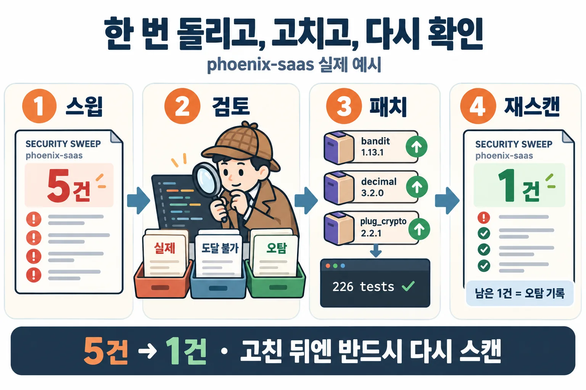

# 예시: 개발 머신 한 대를 한 번 스윕하고, 하나를 고쳐서 다시 확인하기



실제 개발자 맥북의 `~/projects` 아래 프로젝트 26개를 `security-sweep`으로 한 번 돌린 결과입니다. 공개를 위해 프로젝트명·경로·파일명을 가명으로 바꿨고, 근거 코드 줄은 지웠습니다(`file:line`만 남김). 취약점 ID, 패키지 버전, 심각도, 우선순위는 실제 결과 그대로입니다.

> 이 보고서는 **도구가 한 번 돌았을 때 나오는 1차 결과**입니다. 우선순위는 규칙으로 매긴 것이고, "진짜 위험한가"는 사람(또는 Claude)이 코드를 읽고 판정해야 합니다. 아래 2~4단계가 그 과정입니다.

## 1단계 · 한 번 돌리기

```text
/security-sweep:security-sweep ~/projects 전체 점검해줘
```

| 항목 | 결과 |
|---|---|
| 탐지된 프로젝트 | 26개 (npm · PyPI · Hex · Go · Maven) — 그중 취약점이 나온 곳 15개 |
| 취약점 권고 | 고유 75개, **전부 OSV에서 실재 확인** (404 0건, CISA KEV 0건) |
| 우선순위 | P0 **0** · P1 **107** · P2 72 · P3 2 |
| 비밀값 | 3건 (GitHub OAuth 토큰 1, JWT 2) — 모두 `.gitignore`된 build 폴더, 값은 마스킹 |

보고서: [`1-sweep-all/REPORT.html`](1-sweep-all/REPORT.html) · [`REPORT.md`](1-sweep-all/REPORT.md) · [`findings.json`](1-sweep-all/findings.json)

**P1 107건을 겁먹지 말고 묶어서 보세요.** 그중 81건은 `pillow 12.3.0` 하나에 걸린 권고 27개가 프로젝트 3곳에서 반복된 것이고, 18건은 `sharp 0.34.5`가 슬라이드 프로젝트 6곳에서 반복된 것입니다. 실제로 할 일은 "pillow 올리기, sharp 올리기, certifi·bottle 올리기, bandit 올리기" 정도입니다.

## 2단계 · 진짜인지 검토하기 (phoenix-saas 하나)

`phoenix-saas`(Elixir/Phoenix)에서 나온 5건을 코드를 열어 하나씩 판정했습니다.

| 우선순위 | 발견 | 도구 판정 | 사람 판정 | 근거 |
|---|---|---|---|---|
| P1 | `bandit 1.12.5` EEF-CVE-2026-105659 (HTTP/2 리소스 고갈) | imported | **실제 (조건부)** | `Bandit.PhoenixAdapter`가 실제 HTTP 서버. 앞단 프록시가 HTTP/1.1로만 전달하면 위험 감소 |
| P2 | `bandit 1.12.5` EEF-CVE-2026-105660 | imported | **실제** | 위와 같음 |
| P2 | `decimal 3.1.1` CVE-2026-97853 (`Decimal.round/3` DoS) | imported | **도달 불가** | 코드의 유일한 호출이 `Decimal.round(0)` — 자릿수가 상수라 공격자가 조종 못 함 |
| P2 | `plug_crypto 2.2.0` EEF-CVE-2026-105963 (스택 트레이스에 키 노출) | imported | **불확실 (낮음)** | `MessageEncryptor.decrypt`에 잘못된 타입이 들어가 예외가 로그에 남는 경로가 있을 수 있음 |
| P1 | `config/config.exs:36` 하드코딩 비밀값 (EXS-CFG-001) | — | **오탐** | Phoenix가 생성한 LiveView `signing_salt`는 비밀이 아님. `secret_key_base`는 `runtime.exs`에서 환경변수로 주입 |

도구의 `imported`는 "코드 어딘가에서 이 패키지를 쓴다"까지만 말해 줍니다. `decimal`처럼 쓰긴 하지만 취약한 방식으로는 안 쓰는 경우를 가려내는 것이 이 단계입니다.

## 3단계 · 패치하기

작업 중이던 브랜치는 건드리지 않고, `git worktree`로 HEAD를 따로 꺼내 `security/deps-20261023` 브랜치에서 고쳤습니다. 세 패키지 모두 패치·마이너 업그레이드라 비용이 작아서, 도달 불가로 판정한 `decimal`도 함께 올렸습니다.

```bash
mix deps.update bandit decimal plug_crypto
#   bandit       1.12.5 → 1.13.1   (+ thousand_island 1.5.0 → 1.6.0)
#   decimal      3.1.1  → 3.2.0
#   plug_crypto  2.2.0  → 2.2.1
mix compile          # 성공
mix test             # 226 tests, 0 failures
git commit -m "fix(security): upgrade bandit 1.13.1, decimal 3.2.0, plug_crypto 2.2.1"
```

## 4단계 · 그 프로젝트 하나만 다시 스캔하기

```text
/security-sweep:security-sweep ~/projects/phoenix-saas 다시 점검해줘
```

| | 패치 전 (1단계) | 패치 후 (4단계) |
|---|---|---|
| 의존성 취약점 | 4건 (P1 1 · P2 3) | **0건** — osv-scanner `exit 0 (no vulns)` |
| 코드 발견 | 1건 (EXS-CFG-001) | 1건 (같은 항목) |
| 합계 | **5건** | **1건** |

보고서: [`4-rescan-one/REPORT.html`](4-rescan-one/REPORT.html) · [`REPORT.md`](4-rescan-one/REPORT.md) · [`findings.json`](4-rescan-one/findings.json)

남은 1건은 2단계에서 **오탐**으로 판정한 `signing_salt`입니다. 스캐너가 같은 결과를 내는 건 정상이고(결정적이므로), 오탐은 억제 설정으로 숨기지 않고 판정 기록으로 남깁니다.

## 정리

```text
한 번 돌리기 → 묶어서 보기 → 코드로 판정 → 최소 패치 + 테스트 → 그 프로젝트만 재스캔 → 줄어든 것 확인
```

- 스캐너 결과는 **출발점**입니다. 개수(P1 107)보다 "어떤 패키지 몇 개를 올리면 되나"로 읽으세요.
- `imported` ≠ 위험. `not-imported` ≠ 안전. 판정은 코드를 보고 합니다.
- 고친 뒤에는 **반드시 재스캔**으로 사라진 것을 확인합니다. 남은 항목은 이유(오탐, 업그레이드 대기 등)와 함께 기록합니다.

<sub>가명 처리: 프로젝트명·경로는 `phoenix-saas`, `desktop-app`, `course-slides/...` 같은 이름으로, 관례적이지 않은 디렉터리·파일명은 `dirN`/`fileN.ext`로 바꿨습니다. 원본 스캐너 출력(`raw/`)은 git 메타데이터(저장소 URL·작성자 이메일)를 담고 있어 공개하지 않았습니다.</sub>
